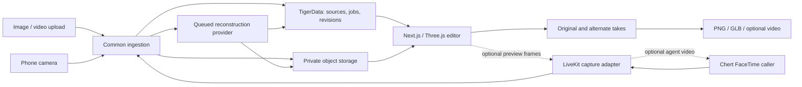

# Prometheus::create - Project canonical baseline

**Capture a scene. Make its objects editable. Create another take.**

Final planning deliverable for a **solo HackUTA 2026 build**. Former working names: Rift, then Daedalus. Prometheus::create is the selected name (ADR-001); the interface should retain familiar labels such as Project, Source, Take, and Export. The name evokes creation and invention. The event's specific theme is Homer's Odyssey, so the presentation should connect the product to exploring and returning to a captured place; Greek branding alone is not the theme argument.

This plan follows schema 2 and the nine sections of the [toolkit PLAN template](https://github.com/Jelatinone/hackathon-toolkit/blob/d34da50829c5ded6c3e38bf0415d82b7419a983e/templates/PLAN.md), inspected through the connected GitHub tools at commit `d34da50829c5ded6c3e38bf0415d82b7419a983e` on `production`. Its [project contract](https://github.com/Jelatinone/hackathon-toolkit/blob/d34da50829c5ded6c3e38bf0415d82b7419a983e/docs/PROJECT_CONTRACT.md), [formats](https://github.com/Jelatinone/hackathon-toolkit/blob/d34da50829c5ded6c3e38bf0415d82b7419a983e/docs/FORMATS.md), and [playbook](https://github.com/Jelatinone/hackathon-toolkit/blob/d34da50829c5ded6c3e38bf0415d82b7419a983e/HACKATHON_PLAYBOOK.md) supply the workflow. No toolkit files were changed. Kickoff (2026-11-14) found the starter `prometheus-create` (Next.js 16.4.6, React 19.3, TypeScript, Tailwind 4) with the toolkit pinned at `toolkit/`; HK-001 adds the shared baseline on `feat/HK-001-foundation` (evidence: `docs/changes/HK-001.md`). No external service has been tested.

The product and architecture decisions below are the recommended build baseline. `proposed` distinguishes this finished planning document from an approved, executable project baseline with verified access and commands. It does not mean that the document is unfinished.

```yaml
schema_version: 2
project_name: "Prometheus::create"
event_name: "HackUTA 2026"
project_status: "ideation"
plan_version: 4
approval: "proposed"
approval_ref: null
updated_at: "2026-11-14T23:50:00-06:00"
timezone: "America/Chicago"
code_start: "2026-11-14T12:00:00-06:00"
code_end: "2026-11-15T00:00:00-06:00"
feature_freeze: "2026-11-14T21:00:00-06:00"
submission_deadline: "2026-11-14T23:59:00-06:00"
release_owner: "Cody - solo builder and integration owner"
stable_branch: null
base_release: null
current_stable_release: null
```

**Clock warning:** the end and submission timestamps above conservatively use the supplied opening deck, page 32. The [official website](https://www.hackuta.com/) instead describes a noon-to-noon coding window. These conflict. The feature freeze is our earlier internal cutoff. Until an organizer resolves the discrepancy, produce and submit the early version, stop coding at the earlier cutoff, and treat the second half of the 24-hour schedule as conditional. Do not silently correct AM to PM. H+0 throughout this plan means the official start, not the moment implementation begins; elapsed planning time must be deducted.

## 1. Product contract

### Current continuation v4: Track A and Track B (2026-11-14 23:50)

**Authority:** Cody asked to split PLAN v3's still-unimplemented continuation into **Track A** and **Track B** for two agents working in parallel over the next four hours. He starts each agent with `implement-next-checkpoint` on a named track. This replaces v3's "one agent, one branch" rule. It does not replace v3's objective, scope, exclusions, acceptance rules, risks or budget, which still apply (read the v3 block below). At the split, production is at `be482e2` and none of the v3 steps 1–5 is implemented. The only work done is that the paid round-table PLY was recovered locally. Contracts still need Cody's approval. No push, tag or deployment is authorized. The official-clock warning above is unchanged: Cody's four-hour window is his instruction, not a corrected event deadline.

**Tracks** (ownership globs in `lanes.json` under the keys `track-a` and `track-b`; protocol in `docs/LANES.md`):

| Track | Task / note | Branch / worktree | Dev port | Checkpoints in order | Owns (summary) |
| --- | --- | --- | --- | --- | --- |
| **A: generation** | HK-011, `docs/changes/HK-011.md` | `feat/HK-011-track-a` at `../prometheus-create-capture` | 3001 | CP-007 → CP-008 → CP-009 → CP-010 | `lib/reconstruction`, `app/api/reconstruction`, `tests/reconstruction`, capture paths |
| **B: editor** | HK-012, `docs/changes/HK-012.md` | `feat/HK-012-track-b` at `../prometheus-create-editor` | 3003 | CP-011 → CP-012 → CP-013 → CP-014 → CP-015 | `components/editor`, `lib/editor`, `lib/scene`, `lib/export`, editor/scene tests, package files |

**Running a track:** "Implement the next checkpoint on Track A" means `implement-next-checkpoint` assigned to HK-011, on its branch and worktree. It selects the earliest Track A checkpoint (§5) whose status is not yet `ready_for_review` or `complete`. **Track rule (approved with this split):** a same-track predecessor at `ready_for_review` on that track's branch satisfies `depends_on`, so an agent continues without waiting for integration. A **cross-track** dependency (CP-014 needs CP-008) is satisfied only once that checkpoint is merged into `production`. The agent then runs `git merge production` on its track branch. Each run implements exactly one checkpoint, records evidence in its section of the task note, sets that checkpoint to `ready_for_review` and stops. Task note `checkpoint_id` names the checkpoint in progress.

No agent is assigned to the platform lane (HK-003). A change needed in `lib/server`, `app/api/assets` or `db` is proposed in the requesting task note, and the agent works around it rather than waiting. HK-002 and HK-004 notes remain the history and handoff for this work; they are not reopened.

**Seams fixed now so that neither track waits on the other:**

- **S1 splat asset.** Kind `splat`, binary little-endian 3DGS PLY (`x y z`, `f_dc_0..2`, `opacity`, `scale_0..2`, `rot_0..3`; extra properties allowed). Its centres, scales and rotations are already in the **same object-local space as the normalized mesh** (`geometry.assetId`). The editor applies no extra normalization: both layers sit under one object transform. The file must fit the 50 MB object cap, which is the Supabase bucket limit and is not raised. The recovered provider PLY is 57.1 MB (839,808 splats × 17 float32), so Track A compacts it, for example by dropping unused normals (≈47 MB) or quantizing. It is labelled inferred, never measured depth.
- **S2 outcome.** `ReconstructionOutcome` (Track A-owned type in `lib/reconstruction/runner.ts`) gains `splatAsset: Asset | null`. The job's existing `output.splatAssetId` is set to the same ID. No shared contract changes. A missing or invalid provider splat still yields a succeeded mesh-only job (`splatAsset: null`) plus a recorded warning.
- **S3 editor attach.** `lib/editor/reconstruction.ts` sets `SceneObject.splat = { assetId, enabled: false, validForGeometryRevision: geometry.geometryRevision }` when `outcome.splatAsset` exists. Splat bytes load through the existing private asset download route.
- **S4 batch generate.** Phase 1 runs one user action as **2–3 single-mask child jobs** on the existing API (one durable `jobId` per mask, existing single-mask limit). Track B owns this phase and can ship it without Track A changes. Phase 2 is Track A's investigation of one multi-mask provider job (`individual_glbs` / `individual_splats` / metadata). That phase changes the API or contracts only through a proposal approved by Cody.
- **S5 already-paid round table.** Track A provides a no-cost path that gives the existing round-table job in `prj_ba1f1945c81d48ac9aecf6bb01dc07fa` a stored `splat` asset in S1 form. The source is the saved provider output, or the recovered file `C:/Workflows/Personal/prometheus-create/.verify/v2/round-table-provider.ply`. It makes no new fal request. Through this path Track B gets the same `splatAsset` as a fresh job.

**Checkpoints per track** (full records in §5; v3 step numbers in brackets; target times are pacing, not deadlines):

| Order | Track A: generation (HK-011) | Track B: editor (HK-012) |
| --- | --- | --- |
| 1 (~00:50) | **CP-007** [1] Provider splat to S1 asset: pick `gaussian_splat`, validate the PLY header, apply `normalizeGlb`'s normalization, compact under 50 MB, store as `splat`, S2 outcome, mesh-only fallback. Prove S1 numerically: transformed splat centre bounds vs normalized mesh `localBounds`. | **CP-011** [1] Spark splat layer: check compatibility with three 0.187 and the installed docs, then add a viewport splat layer from a local PLY (synthetic fixture plus the recovered file in dev). Mesh/Splat switch, mesh-only fallback, S3 attach. |
| 2 (~01:45) | **CP-008** [1] S5: the existing round-table job gets a stored S1 splat with no fal call, and a real reload from private storage. | **CP-012** [2]+[3] One object transform drives both layers (translate/rotate/scale, undo, fork, save/reload; no double normalization). S4 phase-1 batch Generate: 2–3 child jobs, per-job status, partial failure/retry without resubmitting a paid job. |
| 3 (~02:45) | **CP-009** [3] Multi-object phase 2: bounded inspection of `individual_*`/metadata mapping. The result is a proposal (API/contract delta plus evidence) or a recorded "child jobs only" decision. **A live multi-mask call needs Cody's approval first** (~$0.02 job + $0.005/mask). | **CP-013** [4] Persistent bottom timeline (play/pause, scrub, time display) and a context-aware right pane (Generate / Objects-Inspector / Source). PNG export at the current playhead and view; source time and take time stay distinct; scrubbing makes no provider calls. |
| 4 | **CP-010** [5b] *Deferrable.* Cached simplified-mesh derivative with the original kept and a visual comparison before any 100k default. | **CP-014** [1–2] Real aligned pair: the CP-008 round-table splat and mesh shown, switched and moved together in the browser on real data. *Cross-track: needs CP-008 merged.* |
| 5 (~03:45 freeze) | n/a | **CP-015** [5a] *Deferrable.* A 5-second authored clip export from the evaluated scene. |

**Integration rhythm:** each agent makes small scoped commits on its own track branch and never commits on `production`. A checkpoint reaches `ready_for_review` only after `npm run verify` passes and its evidence table is in the task note. Cody, or one integrator session, merges ready checkpoints into `production` and marks them `complete`. CP-007/CP-008 should be merged as soon as they are ready, because CP-014 waits on them. If time runs short, defer CP-010 and CP-015 rather than holding the other track. Each agent rolls back its own commits only; the baseline is `be482e2`.

**Shared-file rules:** `package.json`/lock edits (Spark) belong to Track B only. Track A adds no client dependency without noting it. Neither agent edits PLAN, AGENTS, `lanes.json`, contracts, fixtures or the other track's note; deviations are proposed in its own note. A dev server started by `next dev` may rewrite `AGENTS.md`; leave that diff uncommitted on track branches. Only Track A may spend fal money, and only with Cody's approval. Track B tests against existing assets and fixtures.

### Historical continuation v3: one agent on production (2026-11-14)

**Authority and precedence:** Cody's current chat explicitly requests merging the V2 work into production without a tag, one agent on one branch, and a revised plan prioritizing Gaussian splats, 2–3 objects, and editor/timeline flow. This approved continuation supersedes the old lane scheduling and splats-after-motion order for the bounded work below. The historical registry and lane definitions remain for compatibility and history; they are not instructions to launch workers or switch worktrees. Work in the root checkout on `production`; no parallel agents. Existing task notes HK-002 (generation) and HK-004 (editor) own the continuation. Shared contracts still require Cody's approval before changes. This is not blanket approval of every older proposed checkpoint, release, or deployment. No push or new tag is authorized here.

**Observed baseline:** production fast-forwarded from `3b28e66` to `a4ad90e`. Capture and real image-to-mesh/editor/save/export work. Two 35-second Chert calls ended cleanly. Final application tree passed full verify (237 JS tests) and 27 Python tests; later density investigation changed documentation only. A 100k-triangle local derivative reduced the round table from 20.95 MB to 2.00 MB in 2.3s, but is not integrated. Cody reports 12% agent usage remaining and expects a Claude handoff in about 30 minutes; this is capacity guidance, not an event deadline extension. Existing unresolved official-clock warning still applies.

#### Objective
Show and manipulate a small reconstructed scene as splats or meshes, then make image and video output follow a single editor playhead. Preserve the verified capture-to-export journey.

#### Scope and exclusions
First implement a saved splat/mesh pair for one object, then test 2–3 independently editable objects, then a minimal player. Defer room-wide reconstruction, automatic multiview fusion, physics, remote interactive video streaming and fabricated generation controls. Keep the $10 total fal ceiling; reported spend is about $0.06, not an audited balance. Reuse provider results before any new paid job; no generation per playback frame.

#### Inputs and baseline
Read HK-002/HK-004 current continuation and handoff first. `finishReconstruction` currently stores only raw/normalized GLB and writes `splatAssetId: null`; provider PLY URLs exist in ignored proof JSON, not durable app assets. Existing SceneObject.splat and job.output.splatAssetId provide initial attachment seams. SAM 3D returns generated splats and meshes together from image/masks; it does not expose a documented saved-splat-to-mesh or evidence-frame fusion input. Generated splats include inferred surfaces and must not be labeled measured/raw depth.

#### Ordered steps
| Step | Outcome | Task IDs | Owned paths | Dependencies | Verification |
| --- | --- | --- | --- | --- | --- |
| 1 | Persist existing provider PLY and add a minimal Spark-backed Splat/Mesh layer switch | HK-002, HK-004 | lib/reconstruction, components/editor, lib/editor, task notes; dependency files if needed | Existing saved provider output; validate PLY before loading | Real PLY renders; reload works from private storage; no new fal job; mesh-only fallback survives missing/invalid splat |
| 2 | Keep splat and mesh on one object transform and normalization | HK-004 | components/editor, lib/editor, lib/scene | Step 1 | Translate/rotate/scale, undo, fork and save/reload match both layers; no double normalization or duplicated visible surfaces |
| 3 | Test one frame containing 2–3 objects, then integrate batch Generate UX | HK-002, HK-004 | lib/reconstruction, app/api/reconstruction, components/editor, tests/reconstruction | Clear source frame with separate masks; bounded paid test | Actual individual_glbs/individual_splats, masks and metadata associate correctly; each object moves independently; partial failure and retry do not double-charge |
| 4 | Add persistent bottom timeline with play/pause, scrub and current-time display; context-aware right pane | HK-004 (HK-008/HK-005 consumers) | components/editor, lib/editor, lib/scene, lib/export, task notes | Steps 1–3; existing rational take time contracts | PNG exports exactly current playhead/view/layer; no separate frame selector; source time and take time remain distinct; scrubbing makes no provider calls |
| 5 | Only then add a short authored video export and optional cached simplified mesh delivery | HK-004 (HK-005/HK-008 consumers), HK-002 | editor/export/reconstruction paths | Verified deterministic evaluated scene at a frame | 5-second clip matches playhead scene; original asset preserved; visual simplification comparison before defaulting to 100k |

#### Acceptance and verification
For the next agent, first gate is one real aligned splat/mesh pair, not a full feature suite. Use Spark's Three.js renderer in the browser; inspect installed-version docs and compatibility before adding it. Browser-local rendering avoids introducing a render server without a demonstrated need. Server-side generation/persistence remains asynchronous. Positional replay data describes state; it does not replace rendering. Consider offline server export only if local recording fails the demo requirement.

One scene/take model serves both photo and video: a photo is the currently evaluated frame, a video is a range over authored scene/camera animation. Captured video is source evidence, not automatically a time-varying 3D reconstruction. A static source starts at frame 0 and can be placed into an authored duration. Timeline stays visible; no photo/video project split. Right pane shows Generate settings/status when generating, Objects/Inspector when editing, and source details when inspecting evidence. Layer selection should not prevent moving the same object. Show real queue/running/download stages, not invented percentages. Only expose controls backed by implemented behavior; mesh preview detail can be local postprocessing, not a fake model aggressiveness setting.

Provider multi-object API support is documented, not yet live-tested here. The HTTP adapter currently caps masks at one and the runner picks a combined GLB; widening that limit alone is insufficient. First inspect a bounded provider response and object-index mapping. Prefer one user action with 2–3 tracked single-object child jobs if shared output contracts cannot represent a batch safely; the UI must disclose this and budget each job. Do not infer scene-relative placement from independently centered meshes. Required general checks remain `npm run verify`, focused geometry/scene tests, and an actual browser journey; provider/schema documentation alone is not success evidence.

#### Risks and rollback
Splat/mesh coordinate mismatch, large PLY downloads/GPU memory, opacity sorting and inferred hidden geometry are the first risks. Preserve full-resolution assets and mesh-only view; toggle only one representation by default. Cache generation by existing request IDs and compatible inputs; do not regenerate on layer switch, scrub or export. Preserve raw source frames separately from inferred geometry. Stop the splat spike after one bounded implementation attempt if it threatens the running demo and hand off the exact blocker. Roll back continuation commits to `a4ad90e`; do not move existing stable tags.

#### Decisions requiring approval
No questions needed for this planning/merge pass. Directly requested direction (single branch, splat priority, multiple objects, shared timeline) is approved. Spark/local-rendering and the exact interaction details above are implementation recommendations; they do not authorize shared-schema expansion, new hosting costs or remote publication. Confirm the official event window with Cody before any work that would exceed the currently recorded cutoff.

Primary references checked 2026-11-14: [fal SAM 3D schema](https://fal.ai/models/fal-ai/sam-3/3d-objects/api) (multiple masks, individual outputs, metadata), [Spark overview](https://sparkjs.dev/docs/overview/) (Three.js integration, PLY support, object transforms).

```yaml
primary_user: "A filmmaker, video editor, or creator who wants to reshape a captured scene; the demo uses a small interior with furniture."
user_problem: "Captured footage preserves appearance but does not provide individually editable objects or a safe way to explore another arrangement or action."
user_decision_improved: "Choose an alternative object placement, scale, camera, or modeled action before recreating or filming it."
one_sentence_promise: "Turn a captured view into an editable scene, preserve the original, and export another take."
core_demo: "Capture through a phone upload or Chert FaceTime feed, select an object, obtain an estimated mesh, fork the take, change its placement or scale, save, and export PNG plus GLB."
demo_30_seconds: "Show a real captured view, select its chair or prop, switch between original and edited takes, and open the exported result."
demo_3_minutes: "Show capture entering the shared pipeline, inspect the estimated object, correct its scale, fork and edit, reload the saved take, and open the exports; show the actual sponsor contribution."
claim_boundaries: "A small scene and a few rigid objects; estimated hidden geometry and dimensions; no guaranteed full-room reconstruction, photorealistic removal, physical measurement, or automatic mechanism discovery."
```

### Product decisions

- **Web first:** mobile capture and project access; desktop editing. No native iOS application in this build. Home-screen installation is optional.
- **One persistent editor:** top menus, left tools, central viewport, right inspector, bottom timeline. Tools change selection and editing behavior; imports and exports do not replace the workspace.
- **Meshes are the editable geometry:** generated and imported triangle meshes use the same object schema. Detailed geometry is allowed; objects are not restricted to primitive shapes. Simplified collision geometry is a separate approximation.
- **Splats are appearance assets:** optional per-object or background rendering, never the authoritative collision or edit model.
- **Chert is an ingestion adapter:** the agent calls a participant, guides a scan, and routes selected caller-camera frames through the same backend as ordinary camera and video imports. It does not create a separate editing product.
- **Return video is stretch:** rendering another person's edits back into the same FaceTime call is explicitly optional and comes only after ingestion works.
- **Forking is central:** the first release supports duplicate takes that share immutable assets and preserve the original. Arbitrary-time simulation branching is later.
- **AI proposes; the user corrects:** masks, geometry, labels, and optional physical assumptions retain their evidence and provenance. Rendering uses the scene renderer, not an AI video generator.

### The solo demonstration

Use a well-lit chair or tabletop prop with a visually distinctive silhouette, plus a simple floor or background. Capture one clear anchor view and a short scan. Reconstruct **one object first**, place it in an editable scene, duplicate the take, and move or resize it. The source remains visible in a reference panel. Export the edited scene through the original estimated camera or a user camera.

This supports the filmmaking direction and a home-staging interpretation without building two applications. A room feed is accepted as input; that does not imply that every wall, hidden surface, or moving person is reconstructed. A book-and-lever physics scene is the optional follow-on proof, not a second mandatory demo.

### Desktop interaction contract

```text
 File  Edit  View  Scene  Help     Project / Take      Saved   Capture   Export
 ---------------------------------------------------------------------------
 Select |                                                    | Objects
 Lasso  |                   3D viewport                      | Inspector
 Move   |                                                    | Transform
 Rotate |       Source reference / Before-After toggle       | Geometry
 Scale  |                                                    | Appearance
        |      Mesh / Capture appearance / Wireframe         | Evidence
 ---------------------------------------------------------------------------
 Source [clip + source time]     Take [duration + playhead]    Play / Reset
 Camera       |-----------------------------------------------------------|
 Chair        |--------------------- keyframes / motion -------------------|
```

| Area | Behavior | MVP boundary |
| --- | --- | --- |
| Top menu | File: import, save, download project, export. Edit: undo/redo/duplicate/delete. View: source, grid, wireframe, camera. Scene: fork take. | Dropdowns and an export side panel; avoid blocking custom modal workflows. |
| Left tools | Select, Lasso, Move, Rotate, Scale. Tooltips show shortcuts. | Geometry means mask correction or mesh replacement; no Blender-scale modeling suite. |
| Viewport | Orbit/pan/zoom; click to select; outline selected object; gizmo follows selection. View cube and source-camera reset. | Free 3D editing is allowed. Egress's overhead-only rule does not transfer to this project. |
| Right inspector | Object list; name, position, rotation, dimensions, scale; geometry revision; source evidence; estimated/user-confirmed labels. | Physics and joints appear only if implemented. Unavailable controls explain why instead of appearing functional. |
| Bottom timeline | Persistent Take clock. Collapsible Source strip has a separate clock. Tracks use the same take playhead. | Initially duration, seek, play, reset, and a simple camera/object track; no audio editing or full nonlinear editor. |
| Project / Take switcher | Original and named alternatives, with saved status. | Fork creates a separate revision; no branch merges or multi-user conflict resolution. |
| Capture panel | Upload, Phone camera, Video, FaceTime. Progress and errors remain in this panel. | All produce the same source records. |

Use `V` select, `L` lasso, `W/E/R` move/rotate/scale, `F` frame selection, Space play/pause, and standard undo/redo shortcuts, disabled while typing in a field. Numeric fields and visible controls remain available without shortcuts. Use the ADR-002 palette (warm white background, charcoal text, vermilion hover accent); selection, warning, and provenance must also have text or icon cues.

**Selection:** suggested objects highlight on hover. A click selects an existing object. Lasso on the source view creates an image-space polygon, rasterized into a mask at the source's actual resolution; it does not magically select hidden 3D surfaces. A mask can request a new mesh or refine a proposal. In the 3D viewport, lasso initially selects existing objects by projected bounds; splitting an arbitrary mesh is deferred.

**Edit scope:** the inspector explicitly shows **Scene** or **Keyframe**. Scene edits change the selected take's baseline and invalidate dependent simulation. Keyframe edits affect only a supported animated channel at the playhead. Auto-key is off by default. Selection, playback, orbiting, and inspecting source frames never save geometry changes.

### Mobile and cross-device flow

Sign in, select/create a project, choose capture or upload, see progress, and open the project on the laptop. Use a hosted email OTP flow and private file storage; do not build authentication from scratch. Test one real phone and the demo laptop. HTML camera capture is a browser hint with uneven support, so the file picker is always available. [Capture attribute documentation](https://developer.mozilla.org/en-US/docs/Web/HTML/Reference/Attributes/capture)

Mobile editing is limited to previews and project access. If authentication setup fails, a pre-provisioned demo account is an honest fallback; a publicly writable project URL is not an account system.

## 2. Event requirements and proofs

The supplied evidence is `HackUTA 2026_compressed.pdf`, 80 pages, from the user's Downloads folder. Relevant image-only slides were visually inspected, including the Chert challenge and MLH sponsor slides. Page references below are one-based PDF page numbers. Sponsor presence, a prize category, and a tested integration are separate facts.

| Requirement ID | Official source and exact clause | Verified at | Constraint/proof | Owner | State | Evidence/limitation |
| --- | --- | --- | --- | --- | --- | --- |
| RULE-001 | [HackUTA FAQ](https://www.hackuta.com/), early-start answer: work during official hacking window; open-source libraries/templates allowed with fresh start and credit. | 2026-11-14 | Create a fresh app; record reused libraries and generated code. | Cody | planned | Public FAQ inspected. No starter exists; full AI-use and submission rules still need confirmation. |
| RULE-002 | Deck p.32 versus website coding-window FAQ. | 2026-11-14 | Resolve the conflicting end/submission clock; use the earlier header cutoff meanwhile. | Cody | planned | Deck shows midnight end and late-Saturday submission; website says noon-to-noon. |
| RULE-003 | Deck p.40: robustness, Homer's Odyssey, creativity. | 2026-11-14 | Reliable original-to-alternative journey; explain exploration and return to a preserved scene. | Cody | planned | Theme wording inspected; name alone is insufficient. |
| RULE-004 | Deck p.42: "3 minutes to present" and "2 minutes for Q&A". | 2026-11-14 | Rehearse a three-minute demo plus two-minute questions. | Cody | planned | In-person science-fair format; location shown as UH. |
| RULE-005 | Deck p.43 and p.68 refer to MLH guidelines / code of conduct. | 2026-11-14 | Confirm event-specific eligibility, AI disclosure, submission edits, public access, and asset licensing. | Cody | planned | General references are not a complete competition ruleset. |
| RULE-006 | [MLH event listing](https://www.mlh.com/events/hackuta-53) and deck p.18, 54-60, 72. | 2026-11-14 | Choose only tracks supported by the final implementation and event submission options. | Cody | planned | Online category pages reported submissions not open when inspected; actual submission destination remains unverified. |

### Sponsor targeting: one product, at most three active targets

| Track ID | Exact prompt clause/source | Essential technology/capability | Proof scene | Current state | Gap/limitation |
| --- | --- | --- | --- | --- | --- |
| SP-001 | Chert, deck p.18: "uses FaceTime video to see what you show it, show you what you need, or both." | Chert FaceTime API; real caller video ingestion into Prometheus::create. | Agent places an opted-in call, participant changes camera view, new frames enter the project and drive object selection/reconstruction. | planned | Primary target. Requires an assigned outbound-video line and caller-camera capture. iMessage is optional. |
| SP-002 | [Best Use of Tiger Data](https://www.mlh.com/events/hackuta-53/challenges/019fcfdb-abbc-d470-b762-e73f1ee414d2): "show us how Tiger Data powers your project." Deck p.55. | Actual hosted PostgreSQL project/revision/source data; optional capture-event history. | Save a fork, refresh on another device, retrieve source observations and their timestamps from the real database. | planned | Primary target. Useful persistence qualifies the design rationale; tiny demo data does not establish performance at scale. |
| SP-003 | [Best Use of Gemini API](https://www.mlh.com/events/hackuta-53/challenges/01953de4-ee8b-0807-88b1-86bb6abbf410), deck p.54. | Gemini used for capture guidance, object suggestions, or evidence-grounded edit proposals. | Change the caller's view; agent responds to that new view and identifies a target tied to a saved frame. | planned | Secondary target only if it reuses the capture agent. fal reconstruction alone is not Gemini use. |
| SP-004 | Xome sponsor introduction, deck p.19. | No technical challenge or required API was provided. | Explain how editable interior captures could support remote staging; demonstrate the same furniture scene. | deferred | Product relevance, not a verified prize target or Xome integration. Do not invent a Xome API or claim partnership. |
| SP-005 | Best Use of ElevenLabs, deck p.72. | Actual ElevenLabs voice generation. | Agent speaks using the integrated service. | deferred | Add only if voice is already needed and integration takes at most 30 minutes. Gemini native audio removes the need for a separate TTS service. |
| SP-006 | MongoDB Atlas, deck p.58 and [MLH listing](https://www.mlh.com/events/hackuta-53). | Actual Atlas persistence. | Would require the database to be used meaningfully. | deferred | Choose TigerData; do not add a second application database to collect a track. |
| SP-007 | Vultr, deck p.59; GoDaddy Registry, p.60. | Real hosting or qualifying domain use. | Live deployment or domain resolves to the tested build. | deferred | Opportunistic only if it replaces an already needed service within 30 minutes; verify category terms first. |
| SP-008 | FaZe challenge p.13; Solana p.56; SpaceXSI p.50/57; hardware p.73-74. | Fan engagement/monetization, blockchain, specified development workflow, or hardware respectively. | None in the planned product. | deferred | Poor fit or extra work. Do not claim workflow raffle eligibility from unrelated AI use. CIQ, Mouser, and other sponsor logos do not establish a software prize requirement. |

### Chert feasibility gate

The correct name is **Chert**, not Chet. Its managed API can place FaceTime calls through an assigned line into a LiveKit room. Outbound video, incoming caller-camera capture, and agent video are separate capabilities; an audio call or a connected room proves none of the others. [Chert FaceTime overview](https://www.trychert.com/facetime), [outbound API](https://docs.trychert.com/facetime/outbound)

**First 60-90 minutes of implementation:** obtain the organizer's project/line access; place a test call to Cody's own or an explicitly consenting test device; prove fresh caller frames reach the common ingestion endpoint; hang up and repeat. Record frame timestamps and a changed object/view. Do not use a canned frame to pass this gate.

The documented Chert CLI is for macOS/Linux and does not support native Windows. Use the managed outbound API from the web backend and a Linux-hosted capture agent; WSL is only an alternative after an actual successful call test. The open-source browser connector is experimental and is not a proven substitute for caller-camera ingestion on this Windows machine. [CLI quickstart](https://docs.trychert.com/facetime-cli/quickstart), [connected GitHub README](https://github.com/cherthq/chert-facetime-opensource)

Failure fallback: ingest normal phone/video uploads and keep the complete editor demo. If only Chert's outbound display works, an AI-guided display could fit part of the challenge, but it must be described as a different proof; it does not prove the requested scan-ingestion feature. Do not spend the whole event building a FaceTime transport.

## 3. Scope tiers and release gates

**Capacity assumption:** one builder, no starter, no delegated parallel implementation. Budget roughly 15 hours of focused work within a confirmed 24-hour window, with the remainder for integration, meals/rest, recording, submission, and failures. The early-cutoff version has about 8 focused hours. This is a narrow vertical slice, not a general video editor, CAD package, and reconstruction research project combined.

| ID | Tier | Outcome | Dependencies | Measurable acceptance | Owner | State |
| --- | --- | --- | --- | --- | --- | --- |
| F-001 | CORE | Common image, selected video-frame, and camera ingestion | Foundation | PNG/JPEG and one supported short video yield source records with provenance; invalid input gives a useful error. | Cody | planned |
| F-002 | CORE | Editable mesh object and coherent shell | F-001 | Import GLB; select, move, rotate, uniformly scale; undo; numeric dimensions; no transform applied twice. | Cody | planned |
| F-003 | CORE | Live object reconstruction and lasso | F-001, F-002 | One real photo plus mask produces a usable non-primitive mesh; original evidence is retained; timeout is recoverable. | Cody | planned |
| F-004 | CORE | Original plus alternate take | F-002 | Fork a take, edit it, switch back to unchanged original, save/reload both. | Cody | planned |
| F-005 | CORE | Cross-device project persistence | Foundation | Same authenticated project opens on phone and laptop; unauthorized project access fails; stale save returns conflict. | Cody | planned |
| F-006 | CORE | PNG and GLB exports | F-002, F-004 | Downloaded PNG matches selected camera/take; GLB reopens with correct dimensions, transforms, materials. | Cody | planned |
| F-007 | DIFFERENTIATOR | Chert outbound scan ingestion | F-001; capability gate | Real changing caller frames use the identical ingestion contract; two calls clean up correctly. | Cody | planned |
| F-008 | DIFFERENTIATOR | Gemini capture guidance / object suggestions | F-007 or F-001 | A real model response references a fresh frame; suggestions are editable, validated, and not auto-applied. | Cody | planned |
| F-009 | DIFFERENTIATOR | Minimal take timeline and short rendered video | F-004, F-006 | A five-second take seeks/replays; camera or object animation exports in the tested browser's supported format. | Cody | planned |
| F-010 | DIFFERENTIATOR | Simple rigid-body preview | F-002, F-009 | One body falls/collides consistently; optionally one user-configured hinge; reset restores the initial state. | Cody | planned |
| F-011 | STRETCH | Optional splat appearance | F-003 | Mesh and corresponding splat stay aligned under supported transforms; mesh-only rendering remains available. | Cody | planned |
| F-012 | STRETCH | Return edited render through the same FaceTime call | F-007, F-006 | Caller sees changing editor previews while fresh caller frames still enter ingestion; no echo loop or growing queue. | Cody | deferred |
| F-013 | STRETCH | Multi-frame geometry refinement / tracked motion | F-003, F-009 | A supported method improves a named object from additional compatible views, with before/after evidence. | Cody | deferred |
| F-014 | LATER | Automatic mechanisms, full-room dynamic reconstruction, CAD, multi-camera synchronization, collaboration | Proven core | Separate future specification and validation. | Cody | deferred |

**Gate meanings:**

- **STABLE-V0:** fresh starter runs; one GLB renders; schemas and real service smoke tests exist; source/control/output boundaries are documented.
- **STABLE-V1:** upload -> mesh edit -> fork -> cloud save/reload -> PNG and GLB works. A fixture mesh may establish editor reliability, but the build is then labeled an editor prototype, not proven live reconstruction.
- **STABLE-V2:** V1 plus real image-to-mesh evidence and actual Chert ingestion. Claim only the sponsor integrations separately proven. A Chert failure does not erase V1, but blocks the FaceTime-ingestion claim.
- **RC-1:** frozen feature set; no demo-blocking bugs; fresh-session test passes; fallback and footage available.
- **FINAL:** exact release, live link, video, attribution, selected tracks, and submission receipt verified.

No gate is currently passed. After every cut, update features, demo wording, and track selection together.

## 4. System architecture

### Stack decision and alternatives

Next.js is the application framework; TigerData, MongoDB, and SpacetimeDB are persistence/backend choices. They are not four interchangeable frontend stacks.

| Choice | Fit and verified capability | Cost for this solo build | Decision |
| --- | --- | --- | --- |
| Next.js + React + TypeScript | Good fit for app shell, account/project pages, client-side editor, and short authenticated endpoints. Browser interaction belongs in client components. | Keep WebGL state out of server rendering and large request bodies out of API handlers. | **Choose.** Three.js with React Three Fiber for the viewport; small client store for tools and selection. [Next.js boundaries](https://nextjs.org/docs/app/getting-started/server-and-client-components) |
| TigerData / PostgreSQL | Relational ownership and revisions, flexible JSONB manifests, optional time-series capture history. | One database; SQL migration and connection setup. Familiar transaction model supports optimistic saves. | **Choose.** Sponsor fit reinforces a sound storage choice. [TigerData hypertables](https://www.tigerdata.com/docs/learn/hypertables/creating-and-configuring-hypertables), [JSONB](https://www.postgresql.org/docs/current/datatype-json.html) |
| SpacetimeDB | Current docs support TypeScript and Rust modules, reducers, live subscriptions, and procedures that can make external HTTP requests. | Custom module/schema/identity and job integration; its main benefit is live shared state, which is not required here. | **Defer.** Attractive if multiplayer editing becomes central; no unsupported claim that it cannot call external services. [Modules](https://spacetimedb.com/docs/databases/), [subscriptions](https://spacetimedb.com/docs/clients/subscriptions/), [procedures](https://spacetimedb.com/docs/functions/procedures/) |
| MongoDB Atlas | Natural document representation for scene manifests; legitimate sponsor alternative. Large binary assets still need a separate strategy; BSON documents have a 16 MiB limit. | Comparable initial persistence effort; changing databases later during the event gains little. | **Do not combine with TigerData.** Choose only if TigerData access fails before implementation locks. [MongoDB file limits](https://www.mongodb.com/docs/manual/core/gridfs/) |
| TypeScript backend | Suitable for authenticated I/O, validation, job control, revisions, and exports. | Shared types reduce integration work. JavaScript is not the proposed GPU inference engine. | **Default application language.** Profile before considering a rewrite. |
| Rust backend | Useful for proven CPU bottlenecks and native geometry services. | Extra build/deployment interfaces and iteration time; does not solve slow remote inference or poor captures. | **No custom Rust in the hackathon.** Prefer it over C++ later if profiling justifies a native component. |
| Existing Rust/WASM | Rapier exposes a JavaScript/TypeScript API over a Rust physics engine. | Reuses efficient physics without maintaining a native backend. | **Use if physics is reached.** [Rapier](https://rapier.rs/docs/) |
| Small Python capture worker | LiveKit's currently documented automatic Gemini live-video input path is Python-only; its realtime model integration also has Node support for other capabilities. | One small isolated service, not a second general application backend. | **Choose for live camera/agent integration if needed.** Do not assume Node/Python feature parity. [LiveKit Gemini integration](https://docs.livekit.io/agents/models/realtime/gemini/) |

Use hosted Supabase Auth and private Storage for identity and binaries; TigerData remains the sole application data store. This is two provisioned services, but avoids writing account and upload infrastructure. Supabase's resumable upload path is useful for phone clips and unstable connections. [Email OTP](https://supabase.com/docs/guides/auth/auth-email-passwordless), [resumable uploads](https://supabase.com/docs/guides/storage/uploads/resumable-uploads)

### Data flow



The diagram's dashed return path is stretch. The ingestion path does not depend on it. The database does not carry video packets or mesh vertices on every render frame.

| Module/owner | Responsibility | Inputs/outputs | Public contract ID | Mock/live compatibility |
| --- | --- | --- | --- | --- |
| Web shell / Cody | Project, auth, capture controls, editor panels | Project IDs, manifests, user commands | CT-001, CT-003 | Fixture and live scenes use identical schemas; fixture badge remains visible. |
| Ingestion adapters / Cody | Normalize upload, camera, decoded frames, Chert frames | Media + provenance -> immutable source asset | CT-002 | Adapter changes transport, not reconstruction semantics. |
| Capture agent / Cody | Chert/LiveKit call lifecycle, optional spoken guidance, selected-frame capture | Call tracks -> CT-002; optional return preview | CT-005 | Browser/upload fallback cannot be labeled a real FaceTime call. |
| Reconstruction adapter / Cody | Provider submission, status, artifacts, validation | Source + mask -> candidate object assets | CT-002 | Saved fixture response passes schema checks, never live-provider proof. |
| Scene engine / Cody | Geometry, take evaluation, selection, optional physics | CT-001 + take time -> evaluated scene | CT-001 | No database work inside render loop. |
| Persistence API / Cody | Ownership, versions, jobs, exports | Validated commands -> committed revision | CT-003 | Live TigerData save/reload required for sponsor evidence. |
| Export / Cody | Deterministic scene selection, file preparation | Revision + take + camera + time -> artifact | CT-004 | Same scene evaluator as viewport. |

### Mesh and splat reconstruction

**Primary candidate:** fal's `fal-ai/sam-3/3d-objects` endpoint accepts an image and optional object masks and documents GLB meshes, splats, and per-object transforms. Request and validate a real GLB: it is optional in the response schema. Test single-object mapping before multi-object output. The adapter must check file signatures, node structure, axes, units, and whether transforms are already baked; example metadata alone is insufficient. [Endpoint schema](https://fal.ai/models/fal-ai/sam-3/3d-objects/api)

For suggested targets, `fal-ai/sam-3/image` supports text/point/box prompts and returns masks. Lasso creates a mask locally; keep image dimensions and mask coordinates aligned. A detector's confidence score is not a calibrated score for hidden geometry or mass. [Segmentation schema](https://fal.ai/models/fal-ai/sam-3/image/api)

Process: select anchor frame -> confirm mask -> request object -> validate mesh -> normalize to canonical object space -> confirm scale/placement -> accept as a new geometry revision. Generated and user-supplied meshes then follow identical editing behavior. Keep unsuccessful attempts available as job errors, not half-created objects.

**Provider fallback:** Meshy supports asynchronous image-to-3D and a separate one-to-four-image endpoint for views of the same object. Use it only if access is already available and the first provider fails the early proof; do not implement two production adapters during the event. This API requires funded access, so credits and model availability must be checked before depending on it. [Image-to-3D](https://docs.meshy.ai/en/api/image-to-3d), [multi-image input](https://docs.meshy.ai/en/api/multi-image-to-3d)

**Do not make splat training a prerequisite.** The Nerfstudio Splatfacto documentation specifically says mesh export is unsupported, despite broader geometry-export documentation describing other methods. A captured or inferred splat is not automatically a watertight surface. Training, camera estimation, surface reconstruction, segmentation, and repair are separate tasks. No new reconstruction model training in 24 hours. [Splatfacto limitations](https://docs.nerf.studio/nerfology/methods/splat.html)

For optional appearance, use Spark with Three.js. Start with independent object splats, not a fused room scan containing the same object twice. Spark's high-level `SplatMesh` documents uniform scaling; use mesh-only appearance for nonuniform edits unless a separately tested splat transform supports them. Disable an outdated splat after mesh-shape edits. Splats do not acquire physically correct relighting because the mesh has a new material. [Spark SplatMesh](https://sparkjs.dev/docs/splat-mesh/)

Moving an object exposes unobserved background. Use a clean plate supplied by the user, other valid observations, transparent output, or an openly simplified background. Do not leave the original object behind and call the duplicated result a completed edit. Do not add generative image/video rendering to hide this limitation.

### CT-001

```yaml
version: 1
owner: "Cody"
consumers: ["editor", "reconstruction", "persistence", "physics", "export"]
input_schema: "SceneDocument v1 and TakeDocument v1, described below"
output_schema: "EvaluatedScene at an explicit take frame"
errors: "INVALID_SCHEMA, MISSING_ASSET, UNKNOWN_UNITS, UNSUPPORTED_DRIVER, STALE_CACHE"
concurrency_semantics: "Immutable assets and revisions; one active local editor; optimistic server commits"
tests: "Round trip; original/fork isolation; time evaluation; unit and transform normalization"
```

| Entity | Required fields / meaning |
| --- | --- |
| Project | ID, owner ID, title, schema version, active take ID. |
| Source | ID, adapter kind, asset reference, hash, media dimensions, duration/timebase if applicable, captured-at timestamp, permissions, session ID when relevant. |
| Observation | Source ID, source presentation timestamp, frame/mask references, object association, estimated camera, evidence quality. A live arrival timestamp is not a camera pose. |
| SceneObject | Stable ID, name, immutable geometry asset/revision, material reference, base transform, provenance; optional splat and collider references. |
| Take | ID, parent take/revision if forked, scene revision, duration, rational frame rate, source mappings, per-object/camera tracks, optional simulation runs. |
| PhysicalProperties | Body type, collider type/asset, mass or density mode, friction, restitution, confirmed scale; optional joint with axis and local anchors. |
| Proposal | ID, source frame IDs, target object ID, structured suggested change, rationale, assumption labels, status: pending/accepted/rejected. |
| ExportManifest | Scene/take revision, camera, frame range, appearance mode, format, missing features, engine/version information, output asset hashes. |

Canonical 3D convention: right-handed, meters, Y-up, quaternions `[x,y,z,w]`, local mesh vertices plus one object transform. Never silently assume estimated dimensions are measured. Require one user-confirmed length for meaningful room scale; otherwise label units as estimated. Normalize third-party outputs at the adapter boundary and retain the original asset.

### Scene state, source time, and take time

There are **three independent clocks**, plus revision history:

| Concept | Meaning | What changes it |
| --- | --- | --- |
| Scene baseline | Objects, geometry, materials, joints, and baseline properties. | An explicit scene edit creates a revision. It is not a clock. |
| Source time `t_source` | Where an observation occurs in an original clip or live capture session. | Source viewer seek; incoming capture frames. Immutable evidence. |
| Take time `t_take` | The output sequence's playhead, starting at zero. | Play, seek, duration, keyframes, and source mappings. |
| Simulation time `t_sim` | Elapsed solver time since a release/start event within a take. | Fixed simulation steps or reading a baked run. |
| Revision history | What the user changed and saved. | Commits/undo/forks; never derived from a video timestamp. |

Store source presentation timestamps as integer microseconds, take positions as integer frames at a rational frame rate, and physics ticks separately. For a mapped clip, `t_source = sourceIn + rate * (t_take - takeIn)` within its active interval. A held frame has a constant source timestamp. Source video frames must be decoded using their presentation timestamps, particularly for variable-frame-rate phone footage.

**Default import is evidence, not animation.** A still photo supplies one observation. A scan video supplies candidate views; choose an anchor frame for the initial scene. Importing a 20-second scan does not automatically create a 20-second output or make the camera orbit in the final take. New takes default to five seconds only when playback/video is enabled; still export does not require a timeline.

**Moving objects:** do not combine changing poses as if they were a static scene. For MVP, reconstruct an object at a chosen frame and hold it as the baseline. Keep the rest of the video as evidence. Later, separate static background estimation, object-local geometry, camera motion, and observed object motion; reject low-confidence tracks rather than inventing a trajectory. A hand moving around a chair is not equivalent to a rigid multi-view scan of a stationary chair if the chair also moves or becomes occluded.

**One transform driver per object and interval:** baseline, observed motion, authored keyframes, or simulation. A driver supplies an absolute pose in the canonical frame; there is no hidden stack of competing transforms. Explicit authored tracks override observed tracks. A simulation interval takes exclusive pose control from its release frame, initialized from the evaluated pose and chosen velocity. A source clip never overrides that interval implicitly. Structural changes such as collider or mass edits are baseline changes in MVP, not arbitrary mid-simulation keyframes.

**Fork semantics:** MVP copies the small take manifest and scene baseline into an independent take while sharing immutable geometry/media assets. Original is preserved; edits are undoable within the new take. Do not implement a merge engine. Later, Fork from here preserves the prefix and snapshots pose, linear/angular velocities, joint state, engine version, and solver tick at the branch point. Copying only visible positions is insufficient to continue a physical simulation.

**Scrubbing:** keyframes are evaluated directly. Simulation cannot run backward by decrementing a clock; restore a compatible snapshot and step forward, or read a baked pose cache. Cache keys include scene revision, engine version, step size, and initial conditions. Edits invalidate the dependent run. Fixed 1/60-second physics with 30 fps output is a useful starting policy; pin the engine and object insertion order, and verify replay rather than promising universal determinism. [Rapier determinism conditions](https://rapier.rs/docs/user_guides/javascript/determinism/)

### Physics and scaling policy

Display meshes can be detailed and concave. Dynamic collision uses a convex hull or a small compound approximation; static scene collision may use a triangle mesh where supported. Show collision geometry on demand. Colliders are not substitutes for visible reconstructed geometry. [Rapier colliders](https://rapier.rs/docs/user_guides/javascript/colliders/)

MVP scale is positive and uniform. When physics is enabled, stop playback before resizing; rebuild colliders and invalidate caches. Default **Keep mass** avoids quietly changing behavior. Optional **Keep density** recomputes mass with volume (`s^3` for uniform scaling); shape-derived inertia must also be updated. Mass, friction, and joint assumptions are editable and unmeasured unless the user supplies evidence. A selected image does not establish a material's density.

Use fixed and dynamic bodies first. A revolute joint can represent a user-confirmed lever pivot; fixed and prismatic joints are later additions. No automatic hinge discovery is required. No soft bodies, fracture, cloth, or physical accuracy claims. [Rapier body properties](https://rapier.rs/docs/user_guides/javascript/rigid_bodies/), [joint types](https://rapier.rs/docs/user_guides/javascript/joints/)

### CT-002

```yaml
version: 1
owner: "Cody"
consumers: ["upload", "camera", "video", "chert", "reconstruction"]
input_schema: "IngestEnvelope: projectId, sourceId, adapter, sequence, sourceTimeUs, capturedAt, assetRef, dimensions, contentHash, captureSessionId"
output_schema: "Source/Observation IDs; optional ReconstructionJob with source revision and mask references"
errors: "UNAUTHORIZED, UNSUPPORTED_MEDIA, TOO_LARGE, STALE_FRAME, DUPLICATE, PROVIDER_UNAVAILABLE, INVALID_GEOMETRY"
concurrency_semantics: "Idempotent on sourceId plus sequence/hash; immutable observations; stale results never overwrite newer accepted geometry"
tests: "Same fixture via upload and Chert adapters; duplicate frame; out-of-order frame; timeout; missing GLB"
```

An upload uses a signed direct-to-storage path; the API receives metadata, not a large base64 clip. A Chert adapter samples frames into the same asset path and envelope. Persist the user-selected frame and a small useful set of scan observations; do not store an entire live call by default. Apply backpressure and drop old unsaved preview frames. Capture session permissions are explicit and scoped to a project.

Provider jobs have `queued`, `submitted`, `running`, `succeeded`, `failed`, or `canceled` state, provider request ID, input hash, and attempt record. Submit once, store the ID, and poll short status requests or verify callbacks. Reconcile a lost response before issuing another paid job. A canceled or stale completion may become an asset but must not replace a user's newer geometry. Copy accepted outputs to owned storage; temporary provider links are not durable project assets. [fal asynchronous queue](https://fal.ai/docs/documentation/model-apis/inference/queue)

### CT-003

```yaml
version: 1
owner: "Cody"
consumers: ["editor", "capture-agent", "project-gallery"]
input_schema: "SaveRevision(projectId, takeId, expectedRevision, validatedManifest, idempotencyKey)"
output_schema: "New immutable revision ID, asset references, savedAt"
errors: "UNAUTHORIZED, REVISION_CONFLICT, INVALID_ASSET_REFERENCE, INVALID_SCHEMA"
concurrency_semantics: "Compare-and-swap expectedRevision in a database transaction; no silent last-write-wins"
tests: "Two-device stale save; unauthorized read/write; fork isolation; reload after save"
```

Use regular PostgreSQL tables for `projects`, `sources`, `assets`, `takes`, `scene_revisions`, `jobs`, `capture_sessions`, and `proposals`; store small scene manifests in JSONB. Ownership and revision relationships stay relational. Store binary meshes, splats, images, clips, and baked motion in private object storage. Autosave after completed gestures or a short debounce, not at display refresh rate. Keep an IndexedDB recovery copy with an explicit unsynced indicator.

If time permits, use a TigerData hypertable for capture events partitioned by `recorded_at`, with independent `source_time_us`, session ID, sequence, frame ID, quality, and event kind. This distinguishes actual recording time from media time. Query a session interval to populate the source strip and find the latest usable observation. Do not invent wall-clock timestamps from a five-second animation, and do not use a hypertable for every project table. Confirm migration syntax against the provisioned database version. [Hypertable creation](https://www.tigerdata.com/docs/reference/timescaledb/hypertables/create_hypertable)

### CT-004

```yaml
version: 1
owner: "Cody"
consumers: ["export-panel", "preview-return"]
input_schema: "ExportSpec: project/take/revision, camera, appearanceMode, stillFrame or frameRange, resolution, requestedFormat"
output_schema: "Downloadable artifact plus ExportManifest with actual format and omissions"
errors: "UNSUPPORTED_CODEC, TAINTED_CANVAS, MISSING_ASSET, STALE_REVISION, RESOURCE_LIMIT"
concurrency_semantics: "Export pins a revision; subsequent editing does not change an in-flight export"
tests: "PNG dimensions; GLB reopen; take/camera selection; supported-codec playback; no source-time confusion"
```

| Input / output | MVP behavior | Deferred or conditional behavior |
| --- | --- | --- |
| PNG/JPEG import | Anchor view, masks, estimated object mesh, optional image-plane backdrop. | Hidden surfaces remain inferred; no measured room model claim. |
| Video import | Store original; preview supported codec; select a timestamp and extract frames. | Automatic motion tracking, arbitrary codecs, multi-camera synchronization. |
| Phone camera | Same upload/frame path; preserve orientation and dimensions. | Native LiDAR, ARKit capture, background recording. |
| FaceTime feed | Chert adapter emits the same observations; dropped/old frames are identified. | Full-fidelity original camera recording is not assumed from compressed call video. |
| GLB import | Preferred binary mesh format with transforms/materials. | General CAD, arbitrary external texture bundles, rigged character editing. |
| Splat import | Optional known format through Spark; visual reference. | Automatic object splitting or reliable splat-to-mesh conversion. |
| PNG export | Current take/camera/frame; transparent, neutral, or user-supplied background. | Faithful photo replacement requires a clean background and correct occlusion. |
| Image resize task | Resize the selected mesh and render, or use a masked textured plane for an explicit 2.5D cutout result. | A flat cutout is not a full 3D reconstruction. For shrink/move, require a clean plate or use transparent output. |
| GLB export | Editable mesh scene at chosen time, materials and transforms. | Original media, splats, solver state, and joint semantics are not assumed portable in GLB. |
| Project export | Manifest plus referenced assets, or cloud project with a manifest download in early version. | A manifest-only download must say it requires the stored assets. |
| Video export | Optional five-second rendered take; actual supported MIME type and extension. | MP4 on every browser, source audio, frame-perfect original-footage replacement. |

Three.js GLTFExporter supports mesh scenes and animation clips. Bake supported object/camera motion for animated GLB later; retain solver properties in the native manifest. [GLTFExporter](https://threejs.org/docs/pages/GLTFExporter.html)

For the first video proof, test `MediaRecorder.isTypeSupported()` and record the render canvas in the demo browser. Prefer a working WebM over a mislabeled MP4. Real-time capture can drop frames; measure duration and playback. Frame-accurate export requires evaluating each output time and encoding frames with WebCodecs plus a muxer or a separate FFmpeg worker, which is outside the early version. Ensure loaded assets are origin-clean for canvas export. [Codec detection](https://developer.mozilla.org/en-US/docs/Web/API/MediaRecorder/isTypeSupported_static), [canvas capture](https://developer.mozilla.org/en-US/docs/Web/API/HTMLCanvasElement/captureStream)

### CT-005

```yaml
version: 1
owner: "Cody"
consumers: ["capture-panel", "chert-api", "livekit-agent", "ingestion"]
input_schema: "StartCaptureCall(projectId, consentingTestParticipant, requestedMedia, idempotencyKey); room-scoped credentials"
output_schema: "Call/session IDs, capability/readiness state, CT-002 observations, terminal cleanup state"
errors: "LINE_NOT_READY, CALLER_CAPTURE_UNAVAILABLE, NO_FRESH_FRAME, CALL_ENDED, PROVIDER_ERROR"
concurrency_semantics: "One demo call at a time; idempotent create/end; bind all observations to a call and project"
tests: "Answered call; changed caller view; mute/replacement; hangup; second call; no stale frames"
```

The web backend prepares a room/agent and places the managed outbound call. A successful HTTP allocation is not an answered call. Begin guidance only at the documented bridge-ready event. The capture agent subscribes to the actual caller-video track, handles replacement/mute/end, and publishes observations to the common ingestion API. An agent avatar on the phone does not prove that the backend receives caller video. [Outbound lifecycle](https://docs.trychert.com/facetime/outbound), [caller vision contract](https://docs.trychert.com/facetime-cli/video)

Guide the caller to move slowly around stationary objects, maintain overlap, avoid glare, and hold a clear anchor view. Gemini can provide context-aware capture guidance and object labels using fresh frames; fal performs the geometry task. Validate any structured proposal against the application schema and require an explicit accept action. Schema-conforming output is not proof that a measurement is correct. [Gemini structured output](https://ai.google.dev/gemini-api/docs/structured-output)

**Optional return preview:** the editor renders a lower-resolution preview, sends only the latest frame to the capture session, and the agent publishes it on its outgoing video track. Start with 1-5 fps, labeled as a scene preview, while keeping caller-camera ingestion independent. Chert requires the outgoing video and speaking audio to come from the appropriate same agent participant. Test end-to-end on the caller's phone, not just in LiveKit. Prevent feeding returned previews back into scene capture. No remote-control or native AR overlay is implied.

### Deployment and service boundaries

- Next.js web/API: deploy to the simplest working host, with Vercel as the default candidate. Exact project and URL are not created yet.
- LiveKit/capture agent: persistent Linux process, preferably managed agent hosting. It must survive browser refresh and cannot live inside a short web request.
- GPU inference: hosted model API. No GPU cluster or custom CUDA build in the critical path.
- Storage/auth: Supabase. App metadata: TigerData. Provider keys and service-role credentials remain server-side.
- Short web endpoints submit/query jobs; long media processing belongs in a worker. Next.js documentation notes that host timeouts can terminate long-running handlers. [Deployment caveats](https://nextjs.org/docs/app/guides/backend-for-frontend)
- Starter layout: `lib/contracts/` (CT-001..CT-005 zod schemas, ports, generated JSON Schema), `lib/reference/` (in-memory backend), `lib/assets/` (GLB inspection), `fixtures/`, `tests/` (contract, conformance, lane checks), `scripts/`, `docs/changes/`, and the pinned `toolkit/`. Lane-owned paths such as `components/editor/`, `lib/scene/`, `lib/server/`, `db/`, and `services/capture-agent/` are listed in `lanes.json`.

## 5. Work packages and checkpoints

**One owner:** Cody is builder, reviewer, integrator, presenter, video editor, and submitter. These are sequential responsibilities, not four imaginary workstreams. Allocate the IDs below only in the new project. Each task gets one branch and `docs/changes/<TASK-ID>.md`; do not run concurrent app edits in the same checkout. Separate worktrees are only needed if parallel work is explicitly introduced later.

The first task includes creating the starter because none exists. Toolkit kickoff assumes an existing starter; it does not scaffold the application. Scaffold first during the permitted window, then adopt the pinned toolkit. The inspected toolkit tree has **no `scripts/` directory**, although its README advertises utility commands. Use its manual-adoption path at this pin; do not pretend the advertised validator/bootstrap commands ran.

| Task ID | Checkpoint ID | Branch | Owner | Owned paths | Dependency IDs | Acceptance / test | Status |
| --- | --- | --- | --- | --- | --- | --- | --- |
| HK-001 | CP-001 | feat/HK-001-foundation | Cody | App scaffold, package/lock files, lib/contracts, PLAN.md, docs/DECISIONS.md, toolkit adoption | None | Runnable shell, GLB fixture, actual commands recorded; rules and account access checked. | merged |
| HK-002 | CP-001 | feat/HK-002-risk-proofs | Cody | services/capture-agent, isolated provider adapters, docs/changes/HK-002.md | HK-001 | Real Chert caller frame and real image-to-mesh request; record failures and cut decision. | planned |
| HK-003 | CP-002 | feat/HK-003-ingest-persist | Cody | app project/capture routes, lib/server, db, auth/storage | HK-001, HK-002 | Upload and Chert frame share CT-002; authenticated save/reload and unauthorized rejection. | planned |
| HK-004 | CP-002 | feat/HK-004-editor | Cody | components/editor, lib/scene, editor state | HK-003 | Select, lasso, transform, undo, source reference, mesh acceptance. | planned |
| HK-005 | CP-003 | feat/HK-005-takes-export | Cody | Take commands, exporters, export panel, journey tests | HK-004 | Original/fork isolation; PNG + GLB reopen; exact revision saved. | planned |
| HK-006 | CP-003 | feat/HK-006-demo-proof | Cody | Integration fixes, sponsor evidence, docs/demo, submission draft | HK-005 | STABLE-V1 and, where actually proven, V2; first usable recording. | planned |
| HK-007 | CP-004 | chore/HK-007-early-release | Cody | Release records, docs/demo, final bug fixes, submission artifacts | HK-006 | RC-1 and earlier submission readiness; receipt after actual submit. | planned |
| HK-008 | CP-005 | feat/HK-008-motion | Cody | Minimal timeline, animation, optional Rapier, video export | HK-007 | Only after confirmed extra time: short take, basic motion/physics and supported video playback. | planned |
| HK-009 | CP-005 | feat/HK-009-appearance | Cody | Optional Spark adapter or return-preview adapter, targeted checks | HK-008 | Choose at most one stretch: aligned splats OR duplex FaceTime preview. | planned |
| HK-010 | CP-006 | chore/HK-010-final | Cody | Release, evidence, video, submission records | HK-008 | Confirmed-window final regression, final artifacts, receipt and rehearsal. | planned |
| HK-011 | CP-007, CP-008, CP-009, CP-010 | feat/HK-011-track-a | Track A agent (assigned by Cody) | `lanes.json` → `track-a`; docs/changes/HK-011.md | HK-002, HK-004 (merged in production `be482e2`) | Per checkpoint record below; `npm run verify` plus checkpoint evidence in the note. | planned |
| HK-012 | CP-011, CP-012, CP-013, CP-014, CP-015 | feat/HK-012-track-b | Track B agent (assigned by Cody) | `lanes.json` → `track-b`; docs/changes/HK-012.md | HK-002, HK-004 (merged in production `be482e2`); CP-014 also needs CP-008 | Per checkpoint record below; `npm run verify` plus checkpoint evidence in the note. | planned |

**Tracks A and B (v4, approved 2026-11-14):** HK-011 and HK-012 each span one track's ordered checkpoints on a single branch, under the track rule in §1 "Current continuation v4". The "one owner" text above and the lane replan below are historical for this work.

### Parallel lanes (proposed replan)

On 2026-11-14 Cody directed that, after the HK-001 baseline, work splits into three agent lanes, each with its own branch and worktree. This changes the one-owner assumption above, so it is a **proposed replan**: until Cody approves it (for example through `replan-checkpoint`), the task registry and checkpoints remain authoritative.

| Lane | Task | Branch | Owned paths | Proposed dependency |
| --- | --- | --- | --- | --- |
| Capture & reconstruction | HK-002 | feat/HK-002-risk-proofs | `lanes.json` → `capture` | HK-001 |
| Platform | HK-003 | feat/HK-003-ingest-persist | `lanes.json` → `platform` | HK-001 |
| Editor | HK-004 (then HK-005) | feat/HK-004-editor | `lanes.json` → `editor` | HK-001 |

HK-003 and HK-004 drop their dependency on HK-002/HK-003 because the baseline supplies the shared contracts, ports, an in-memory reference backend, and conformance suites; integration then swaps the reference backend for the platform's. `lanes.json` is the single source for owned paths; `docs/LANES.md` holds the lane protocol. Checkpoint CP-001/CP-002 ordering must be revised in the same approval.

### Schedule and effort caps

| Elapsed window | Solo outcome | Hard cut / parallel non-coding activity |
| --- | --- | --- |
| H+0-2 | Resolve clock/access, create starter, attempt caller-frame capture and one mesh result. | Allocate 30 minutes to the starter, 60 to Chert, 30 to reconstruction. Stop each failed spike at its cap; do not assume parallel builders. Start a short script outline. |
| H+2-4 | Common ingestion, identity/storage, TigerData project save. | Upload fallback if FaceTime is unavailable. Use one project and one demo object. |
| H+4-6.5 | Editor shell, imported/generated object, transform/undo, mask workflow. | Cut automatic room-wide segmentation; keep one selected object. |
| H+6.5-8 | Fork, reload, PNG/GLB, live integration evidence. | Capture the first complete demo now. No new database or provider. |
| H+8-9 | Reliability pass and early feature freeze. | Repair the actual journey; remove dead controls. |
| H+9-10.5 | Video, README/attribution, live-link checks, submission form. | Keep a local fallback and raw footage. |
| H+10.5-12 | Early submission and buffer. | Observe confirmation; stop coding at the earlier cutoff unless the discrepancy is resolved. |
| H+12-14 | Conditional rest/recovery and replan. | Requires confirmed later coding/submission permission; otherwise rehearse only. |
| H+14-17 | Minimal motion timeline, one physics interaction, short video if stable. | Fixed effort cap; do not jeopardize the submitted version. |
| H+17-18 | At most one stretch: appearance OR return preview. | No full-room reconstruction or arbitrary multi-camera alignment. |
| H+18-20 | Conditional second freeze; full journey and failure tests. | Update the script only for proven features. |
| H+20-22 | Final video/export and permitted submission update. | Use recorded proof for unreliable network conditions, labeled honestly. |
| H+22-24 | Buffer, receipt/access checks, three-minute rehearsal. | No new feature work. |

If implementation starts after H+2, compress scope rather than shifting all deadlines forward. Preserve capture, one object, fork, save, and PNG; then GLB and live reconstruction; pursue Chert within its early cap because it is the user's preferred ingestion feature. Cut animation/physics and splats before cutting the completed journey.

### CP-001

```yaml
id: "CP-001"
objective: "Create the fresh starter and resolve transport/reconstruction risk before UI expansion"
task_ids: ["HK-001", "HK-002"]
depends_on: []
owner: "Cody"
approval: "proposed"
approval_ref: null
status: "planned"
acceptance_gate: "STABLE-V0; record real provider and Chert capability evidence or explicit fallback"
cut_fallback: "Normal upload plus labeled imported fixture; do not claim unproven reconstruction or calls"
evidence_ref: null
```

### CP-002

```yaml
id: "CP-002"
objective: "Build one capture-to-edit journey with persistence"
task_ids: ["HK-003", "HK-004"]
depends_on: ["CP-001"]
owner: "Cody"
approval: "proposed"
approval_ref: null
status: "planned"
acceptance_gate: "Same ingestion schema across sources; mesh editing and authenticated reload"
cut_fallback: "One object, one source image, one demo account; no room-wide automation"
evidence_ref: null
```

### CP-003

```yaml
id: "CP-003"
objective: "Complete forks, outputs, and truthful live-integration proof"
task_ids: ["HK-005", "HK-006"]
depends_on: ["CP-002"]
owner: "Cody"
approval: "proposed"
approval_ref: null
status: "planned"
acceptance_gate: "STABLE-V1; STABLE-V2 only if both live reconstruction and Chert ingestion pass"
cut_fallback: "PNG and static GLB; disclose any fixture/manual geometry"
evidence_ref: null
```

### CP-004

```yaml
id: "CP-004"
objective: "Freeze, record, and submit the early version before the conservative cutoff"
task_ids: ["HK-007"]
depends_on: ["CP-003"]
owner: "Cody"
approval: "proposed"
approval_ref: null
status: "planned"
acceptance_gate: "RC-1; FINAL for the early version only after submission confirmation"
cut_fallback: "Keep tested footage and known-good local demo; remove unsupported track claims"
evidence_ref: null
```

### CP-005

```yaml
id: "CP-005"
objective: "Use confirmed extra build time for motion and at most one stretch feature"
task_ids: ["HK-008", "HK-009"]
depends_on: ["CP-004"]
owner: "Cody"
approval: "proposed"
approval_ref: null
status: "planned"
acceptance_gate: "Organizer-confirmed extended window; video/physics proof; optional stretch tested separately"
cut_fallback: "Defer HK-009 and preserve the early release; no additional code if the earlier cutoff stands"
evidence_ref: null
```

### CP-006

```yaml
id: "CP-006"
objective: "Verify the final permitted release, presentation, and submission"
task_ids: ["HK-010"]
depends_on: ["CP-005"]
owner: "Cody"
approval: "proposed"
approval_ref: null
status: "planned"
acceptance_gate: "FINAL on exact integrated revision with accessible artifacts and observed receipt"
cut_fallback: "Retain early submission if updates are not allowed or the later build regresses"
evidence_ref: null
```

Checkpoints CP-007 to CP-015 are the v4 Tracks A and B (§1 "Current continuation v4"). They are approved because Cody's chat instruction of 2026-11-14 23:40 asked for exactly this split, executed through `implement-next-checkpoint`. That approval covers only the scope written in each record: no contract change, push, tag, deployment or unapproved fal spend. Seams S1–S5 are defined in §1.

### CP-007

```yaml
id: "CP-007"
objective: "Track A 1: persist the provider Gaussian splat as an S1 splat asset aligned with the normalized mesh, exposed as outcome.splatAsset"
task_ids: ["HK-011"]
depends_on: []
owner: "Track A agent"
approval: "approved"
approval_ref: "Cody chat 2026-11-14 23:40 — split PLAN v3 into Tracks A/B; PLAN v4"
status: "planned"
acceptance_gate: "Runner tests with a synthetic PLY: valid splat stored (kind splat, under 50 MB, S1 space), output.splatAssetId set, outcome.splatAsset returned; missing or invalid PLY gives a mesh-only success with a warning; no paid call. A numeric S1 check on the recovered round-table PLY against its normalized mesh bounds is recorded. npm run verify passes."
cut_fallback: "Mesh-only jobs unchanged; record the transform blocker exactly"
evidence_ref: "docs/changes/HK-011.md"
```

### CP-008

```yaml
id: "CP-008"
objective: "Track A 2: give the already-paid round-table job a stored S1 splat without a new fal request (S5)"
task_ids: ["HK-011"]
depends_on: ["CP-007"]
owner: "Track A agent"
approval: "approved"
approval_ref: "Cody chat 2026-11-14 23:40 — split PLAN v3 into Tracks A/B; PLAN v4"
status: "planned"
acceptance_gate: "In private project prj_ba1f1945c81d48ac9aecf6bb01dc07fa the round-table job resolves to a splat asset that downloads from private storage after a restart and parses as S1; fal request count unchanged; npm run verify passes."
cut_fallback: "Track B uses a local S1 file for CP-014 with the gap recorded"
evidence_ref: "docs/changes/HK-011.md"
```

### CP-009

```yaml
id: "CP-009"
objective: "Track A 3: decide how a 2–3 object request maps provider individual outputs to masks (S4 phase 2)"
task_ids: ["HK-011"]
depends_on: ["CP-008"]
owner: "Track A agent"
approval: "approved"
approval_ref: "Cody chat 2026-11-14 23:40 — split PLAN v3 into Tracks A/B; PLAN v4 (paid call still needs separate approval)"
status: "planned"
acceptance_gate: "Either a proposal in HK-011 (API/contract delta, evidence of index-to-mask mapping and relative placement) or a recorded child-jobs-only decision; any live call approved by Cody beforehand and its spend reported; npm run verify passes."
cut_fallback: "Child jobs only (Track B CP-012 already ships them)"
evidence_ref: "docs/changes/HK-011.md"
```

### CP-010

```yaml
id: "CP-010"
objective: "Track A 4 (deferrable): cached simplified-mesh derivative for interactive preview"
task_ids: ["HK-011"]
depends_on: ["CP-007"]
owner: "Track A agent"
approval: "approved"
approval_ref: "Cody chat 2026-11-14 23:40 — split PLAN v3 into Tracks A/B; PLAN v4"
status: "planned"
acceptance_gate: "Derivative stored separately with the original kept and referenced; a visual comparison is recorded before any 100k default; no fal charge; npm run verify passes."
cut_fallback: "Defer; full-resolution mesh stays the only geometry"
evidence_ref: "docs/changes/HK-011.md"
```

### CP-011

```yaml
id: "CP-011"
objective: "Track B 1: Spark-backed splat layer with a Mesh/Splat switch and mesh-only fallback (S3 attach)"
task_ids: ["HK-012"]
depends_on: []
owner: "Track B agent"
approval: "approved"
approval_ref: "Cody chat 2026-11-14 23:40 — split PLAN v3 into Tracks A/B; PLAN v4"
status: "planned"
acceptance_gate: "Spark version and three 0.187 compatibility recorded; a browser renders a local PLY splat on an object, switches layers, falls back to mesh on a missing or invalid splat; S3 attach unit-tested; npm run verify passes."
cut_fallback: "Mesh-only view unchanged; record the renderer blocker after one bounded attempt"
evidence_ref: "docs/changes/HK-012.md"
```

### CP-012

```yaml
id: "CP-012"
objective: "Track B 2: one object transform for both layers, and batch Generate as 2–3 child jobs (S4 phase 1)"
task_ids: ["HK-012"]
depends_on: ["CP-011"]
owner: "Track B agent"
approval: "approved"
approval_ref: "Cody chat 2026-11-14 23:40 — split PLAN v3 into Tracks A/B; PLAN v4"
status: "planned"
acceptance_gate: "Translate/rotate/scale, undo, fork and save/reload keep the splat and mesh together with no double normalization; one Generate action tracks 2–3 durable child jobs with real per-job states; partial failure and retry never resubmit a job that has a request ID; npm run verify passes."
cut_fallback: "Single-object Generate stays; transforms remain mesh-only if splats are unavailable"
evidence_ref: "docs/changes/HK-012.md"
```

### CP-013

```yaml
id: "CP-013"
objective: "Track B 3: persistent bottom timeline, context-aware right pane, PNG at the current playhead"
task_ids: ["HK-012"]
depends_on: ["CP-012"]
owner: "Track B agent"
approval: "approved"
approval_ref: "Cody chat 2026-11-14 23:40 — split PLAN v3 into Tracks A/B; PLAN v4"
status: "planned"
acceptance_gate: "Play/pause, scrub and time display; PNG exports exactly the current playhead, view and layer with no separate frame selector; source time and take time remain distinct; scrubbing makes no provider calls; npm run verify passes."
cut_fallback: "Static take with existing PNG export"
evidence_ref: "docs/changes/HK-012.md"
```

### CP-014

```yaml
id: "CP-014"
objective: "Track B 4: real round-table splat and mesh shown, switched and moved together on real data"
task_ids: ["HK-012"]
depends_on: ["CP-013", "CP-008"]
owner: "Track B agent"
approval: "approved"
approval_ref: "Cody chat 2026-11-14 23:40 — split PLAN v3 into Tracks A/B; PLAN v4"
status: "planned"
acceptance_gate: "After merging production with CP-008, the browser shows the stored round-table splat aligned with its mesh, switches layers, moves both together, saves and reloads; screenshots recorded; no fal call; npm run verify passes."
cut_fallback: "Show mesh with the splat alignment gap described; no fabricated splat claims"
evidence_ref: "docs/changes/HK-012.md"
```

### CP-015

```yaml
id: "CP-015"
objective: "Track B 5 (deferrable): 5-second authored clip export from the evaluated scene"
task_ids: ["HK-012"]
depends_on: ["CP-013"]
owner: "Track B agent"
approval: "approved"
approval_ref: "Cody chat 2026-11-14 23:40 — split PLAN v3 into Tracks A/B; PLAN v4"
status: "planned"
acceptance_gate: "A 5 s clip matches the playhead-evaluated scene frame by frame at the take rate; no provider calls during export; npm run verify passes."
cut_fallback: "Defer; PNG at the playhead remains the export"
evidence_ref: "docs/changes/HK-012.md"
```

Only Cody can update accepted architecture, integration, and gate status. Follow the toolkit sequence: kickoff records -> plan checkpoint -> implement the assigned checkpoint -> test identified revision -> review integration -> authorized stable promotion -> demo preparation -> submission preflight -> handoff/recap. `ready_for_review` is not `merged`, and a passing test is not proof of deployment or submission.

## 6. Technical verification and deployment

```yaml
runtime_version: "Node.js 22.18.0 (package.json engines >=22.18.0)"
package_manager: "npm 11.5.2"
install: "npm ci"
unit_tests: "npm test"
typecheck: "npm run typecheck"
lint: "npm run lint"
build: "npm run build"
integration_e2e: null
run_demo: "npm run dev, then open http://localhost:3000"
external_services: ["TigerData", "Supabase Auth and Storage", "fal", "Chert", "LiveKit", "Gemini if capture guidance is enabled"]
secrets_location: "Local ignored environment files and deployment secret stores; never browser bundles, PLAN, or committed logs"
test_environment: "Actual demo laptop browser, one iPhone, dedicated test project, consenting test call, small owned image/video fixtures"
```

Commands come from `package.json` and were executed by HK-001 on 2026-11-14 (evidence: `docs/changes/HK-001.md`). `npm run verify` runs typecheck, lint, tests and build in one pass, adds the lane scope check on lane branches, and prints a task-note evidence table. `integration_e2e` stays null: no browser end-to-end harness exists yet; the lanes add journey checks. The demo laptop runs Node 22.18.0 rather than the earlier Node 24 candidate. The Python version for the LiveKit capture agent is still unselected (HK-002). Chert's documented runtime support is not proof that a complete call has passed on those versions. Do not present proposed commands as already executed.

### Acceptance matrix

| Check | Representative proof | Failure / edge case | Required for |
| --- | --- | --- | --- |
| Ingestion equivalence | Upload and Chert adapter create equivalent source/observation records. | Duplicate sequence and out-of-order arrival do not corrupt the source. | F-001 / F-007 |
| Live call | Changing camera view produces a fresh saved frame; two real calls end cleanly. | Mute/removal/disconnect stops fresh-frame claims and releases the room. | Chert claim |
| Reconstruction | New user image + mask yields a viewable non-primitive mesh with job provenance. | Missing GLB, timeout, unsupported input, malformed metadata. | Reconstruction claim |
| Transform normalization | Known cube/axis fixture and generated object preserve size/orientation through import/save/export. | Provider transforms are not applied twice; unknown scale is labeled. | V1 |
| Lasso mapping | Selection matches the original pixel coordinates after display resize/orientation correction. | Empty or tiny selection is rejected without a paid job. | F-003 |
| Fork isolation | Modify alternate take, reload, switch back to unchanged original. | Stale save is a conflict, not silent overwrite. | V1 |
| Security / ownership | Correct user sees own project and signed assets. | Another user cannot read/write by guessing project or object IDs. | V1 |
| Export | Open PNG and reimport GLB; compare chosen camera, geometry and dimensions. | External texture/CORS failure is visible; omissions are listed. | V1 |
| Time semantics | Scan source time changes independently of a frozen scene; take animation changes independently of the source viewer. | Moving-object clip does not become fused static geometry. | Timeline |
| Physics | Same pinned inputs replay/reset; collider updates after resize. | Editing parameters invalidates a baked run; overlapping dynamic/keyframe drivers rejected. | Physics claim |
| Browser video | Five-second export plays on another device with correct actual MIME and dimensions. | Unsupported codec or dropped-frame result is reported. | Video claim |
| Return preview | Caller sees a new render while ingestion still sees the caller's camera. | Avoid feedback, stale frames and unbounded latency. | Stretch only |

Meaningful checks concentrate on contracts and the real journey, not exhaustive tests of cosmetic panels. Record exact revision, commands/actions, environment, inputs, observed outputs, and limitations in task notes. Mocks can test error handling; they cannot pass a live sponsor gate.

### Proposed operating limits

These are acceptance targets to measure, not observed performance: one room/project, one active call, one reconstruction job at a time, 1-3 editable objects, one short clip up to 30 seconds/50 MB, and one anchor image downscaled to at most 2048 pixels on its long edge for inference where supported. Start near 100k total visible triangles, lower textures for mobile preview, and disable splats first if GPU memory is tight. Validate provider and storage limits separately.

Target responsive manipulation at approximately 30 fps on the actual demo laptop, local selection feedback within 100 ms, save completion within two seconds on the venue network, and one mesh candidate within a five-minute job budget. Record actual timings. These are cut triggers, not promises to judges. Keep a small per-project request cap and confirm funded API credit before repeated inference; no unlimited retries or automatic paid upgrades.

### Canonical demonstration and rollback

**Starting condition:** known-good project, authenticated phone/laptop, ready call line if used, one owned scene capture, original take, no stale jobs. **Action:** capture/import, select, reconstruct, confirm dimensions, fork, transform, save, export. **Observable result:** original unchanged, edited take reloads, output files reopen. **Differentiator:** a real captured object becomes independently editable; Chert supplies an interchangeable remote capture route. **Measured result:** report actual capture/inference latency and geometry limits from the tested run.

Release only an integrated revision that passes its named gate. Create a unique annotated stable tag in the application repository when authorized; record local tag creation and remote publication separately. Preserve a known-good deployed revision, database migration version, fixture manifest, and local export bundle. Prefer additive migrations; rollback the app to a compatible known-good revision without deleting capture history. Exact host URL, stable branch, tag, and restore procedure must be filled during HK-001/HK-007, not invented here.

## 7. Known risks, unknowns and cuts

| Risk ID | Probability/impact | Earliest proof | Owner | Fallback/cut trigger |
| --- | --- | --- | --- | --- |
| R-001 | High / critical: solo scope exceeds time | H+2 capacity review | Cody | One object and one static alternative first; no parallel-team assumptions. |
| R-002 | High / critical: contradictory event clock | Opening deck vs website | Cody | Seek organizer correction; use early header deadlines and conditional second-half plan. |
| R-003 | High / high: Chert line lacks outbound video or caller capture | First real call within 90 minutes | Cody | Phone/video upload; do not count connected-room or agent-video tests as ingestion. |
| R-004 | Medium / high: Windows/agent environment mismatch | Service startup and call smoke test | Cody | Managed API plus Linux agent; avoid unproven native Windows CLI and Mac automation work. |
| R-005 | High / high: reconstruction poor, missing mesh, or slow | One representative object before editor expansion | Cody | One masked anchor; one tested alternate provider if already available; imported detailed fixture labeled honestly. |
| R-006 | High / high: room video contains moving objects and ambiguous scale | Capture review | Cody | Freeze one pose, confirm one real length, keep unmodeled surfaces as reference. |
| R-007 | High / medium: exposed background after moving an object | First resize/move render | Cody | Clean plate, transparent, or neutral background; no photorealistic replacement claim. |
| R-008 | Medium / high: splat/mesh coordinate or occlusion mismatch | One aligned object pair | Cody | Mesh-only render; splats cannot block PNG/GLB. |
| R-009 | Medium / high: phone codec, orientation, or upload failure | First real iPhone clip | Cody | Still photo or browser-supported clip; no on-device transcoding project. |
| R-010 | Medium / high: auth/email/venue-network failure | Cross-device reload early | Cody | Pre-provisioned demo account, saved local project, recorded honest proof. |
| R-011 | Medium / medium: export mismatch or WebM incompatibility | First downloaded output | Cody | PNG + static GLB; record screen demo separately from product video export. |
| R-012 | High / medium: fake confidence in mass/joints or measurements | First property panel | Cody | Label assumptions, allow corrections, defer automatic physics inference. |
| R-013 | Medium / medium: ornamental sponsor integrations | Sponsor proof rehearsal | Cody | Main + Chert + TigerData; Gemini only if actually used; Xome remains a use-case discussion. |
| R-014 | High / high: fatigue and late video/submission work | First complete slice | Cody | Capture footage at V1, reserve early release window, stop feature work at freeze. |
| R-015 | Medium / high: two-way FaceTime render consumes the build | Only after V2 | Cody | Hard one-hour spike cap; drop without affecting ingestion. |

**Cut order:** return-to-FaceTime preview -> splat appearance -> multi-frame refinement -> mechanism inference -> physics/joints -> animated video -> advanced lasso refinement -> extra objects. Preserve source capture, a real editable mesh path, fork, save/reload, PNG/GLB, and truthful provenance. If time still collapses, preserve the editor slice and explicitly narrow the reconstruction/Chert claims.

**Remaining execution unknowns:** organizer-confirmed deadlines and submission updates; Chert project/line access and camera capability; API credit allowance; exact model/package versions; actual starter commands and deployment URL; event-specific AI/asset disclosure rules. These do not prevent delivery of this plan. They do prevent declaring the corresponding feature or release verified.

After freeze, only bounded critical fixes with rollback and renewed checks. Do not add a database, provider, custom native runtime, or new audience-specific product flow late in the event.

## 8. Demo, video and submission

```yaml
presenter: "Cody"
video_owner: "Cody"
submission_owner: "Cody"
script_frozen_at: null
video_rough_cut_at: null
upload_start_at: null
```

### Three-minute script

| Time | Screen action | Claim |
| --- | --- | --- |
| 0:00-0:20 | Original and edited scene side by side. | Captures normally lock creators into what happened; Prometheus::create makes an alternative editable. |
| 0:20-0:50 | Brief real capture through Chert, or clearly identified recording of the tested call; new observation appears. | Remote FaceTime feed enters the same pipeline as phone/video uploads. |
| 0:50-1:25 | Select object, show mask and actual reconstruction result; inspect estimated dimensions. | AI supplies a mesh hypothesis that the creator can correct. Do not wait minutes on stage; disclose a previously completed job. |
| 1:25-2:05 | Fork take, move/scale object, undo once, compare with original. | Edits preserve the source and original take. |
| 2:05-2:30 | Save, refresh/reopen, show source observation in project history. | Real TigerData persistence and cross-device continuity. |
| 2:30-2:50 | Open PNG and GLB; optional short animation only if reliable. | Exported artifacts are usable beyond the editor. |
| 2:50-3:00 | Return to the comparison. | Bound the claim: estimated geometry, small scenes, hidden surfaces unresolved; outline the next step. |

The Odyssey connection is exploration of a captured place and the ability to return to its original state while trying another course. Keep that to one clear sentence; do not turn familiar editor labels into mythology terminology. If Chert fails, demonstrate ordinary capture and omit the FaceTime claim. If a fixture is used, say which asset was prepared and which operations occurred live.

| Scene ID | Claim to prove | Screen action | Recording owner | Footage path | Status |
| --- | --- | --- | --- | --- | --- |
| VID-001 | Genuine capture transport | Change caller's camera view and show matching fresh observation. | Cody | None | planned |
| VID-002 | Real geometry inference | Source/mask, provider job ID, accepted mesh; time compression disclosed. | Cody | None | planned |
| VID-003 | Non-destructive alternative | Fork, transform, compare and undo. | Cody | None | planned |
| VID-004 | Durable project data | Reload selected take from TigerData on second session/device. | Cody | None | planned |
| VID-005 | Useful export | Reopen downloaded PNG/GLB. | Cody | None | planned |
| VID-006 | Optional full-duplex preview | Show caller view and returned editor update simultaneously. | Cody | None | deferred |

Prepare a 90-120-second submission video if the final rules allow it, with intelligible narration and a maximum of three differentiators. Capture footage as soon as each proof passes. A recording is evidence of that tested run, not a claim that a network integration is currently live. Keep the presentation usable without a live call.

| Artifact | Requirement ID | Revision/version | Location | Access/playback check | Evidence |
| --- | --- | --- | --- | --- | --- |
| Application repository and README | RULE-001, RULE-005 | None | None | not_run | Starter not created; credit toolkit, libraries, models, and permitted generated work. |
| Deployed demo and local fallback | RULE-003 | None | None | not_run | Must test a fresh session and note required sign-in. |
| PNG, GLB, project manifest | RULE-003 | None | None | not_run | Reopen outputs from exact demo revision. |
| Demo video | RULE-004 | None | None | not_run | Verify audio/playback and permitted duration. |
| Sponsor proof notes | RULE-006 | None | docs/changes in future app | not_run | Include real request/call IDs with secrets removed; observed results only. |
| Submission | RULE-002, RULE-006 | None | None | not_run | Actual platform and final form unverified; not submitted. |

**Submission receipt:** after actual submission, record confirmation ID/location, timestamp, submitted revision, tracks, and accessible links. Saving a draft or preparing this PLAN is not submission. Use the header's conservative deadline until an organizer resolves it. Verify whether later edits are allowed before replacing the early version.

## 9. Approved updates and gate log

| Plan version | Date | Release | Accepted task IDs / ADR IDs | Updated by | Approval/evidence | Why |
| --- | --- | --- | --- | --- | --- | --- |
| 1 | 2026-11-14 | None | None | Planning assistant | User selected Daedalus, confirmed solo/no starter, specified Chert ingestion and optional return video. No implementation approval or gate evidence recorded. | Final planning baseline aligned with inspected toolkit and current documentation. |
| 2 | 2026-11-14 | None | ADR-001, ADR-002 | Claude Code for Cody (HK-001) | Cody's chat instructions during HK-001 (name and palette); see docs/DECISIONS.md. Plan approval and the lane replan remain proposed. | Record the selected name, visual identity, and logo. |

### Decision register for kickoff

| Decision | Baseline | Rationale / review trigger |
| --- | --- | --- |
| D-001 Name | Prometheus::create (ADR-001); former names Rift, Daedalus | Explicit user choice. |
| D-002 Platform | Next.js web; mobile capture; desktop editor | One codebase and no native distribution overhead. |
| D-003 Representation | Unified editable triangle-mesh objects; separate optional splats/colliders | Geometry, appearance, and collision have different requirements. |
| D-004 Storage | TigerData metadata; private binary storage; hosted identity | Natural project/revision relationships and meaningful sponsor fit. |
| D-005 Runtime | TypeScript app; small Python capture agent where SDK video support requires it; existing Rapier WASM | Avoid custom Rust/C++ and respect actual SDK capabilities. |
| D-006 Time | Source, take, simulation, and revision history are distinct | Prevent scan duration or changing observations from corrupting authored output. |
| D-007 Chert | Outbound capture adapter into shared ingestion | Explicit user clarification; no separate remote-assistant product. |
| D-008 Return call video | Deferred stretch after ingestion works | Explicit user instruction; may show another person's edits, but not required. |
| D-009 AI | Hosted mask/object inference; editable assumptions; no AI-rendered final video | Concentrate effort on user control and dependable outputs. |
| D-010 Scope | One object and static alternate first; motion/physics conditional | Solo capacity and no starter. |
| D-011 Sponsors | Main, Chert, TigerData; Gemini if reused; Xome use-case only | Avoid unrelated integrations and invented track requirements. |
| D-012 Clock | Early submission-ready version; extended build conditional | Opening deck conflicts with public FAQ. |

At kickoff, Cody records accepted architectural decisions in the project-owned `docs/DECISIONS.md`, fills actual commands and access evidence, and references the acceptance in PLAN. Do not mark hypothetical decisions, checkpoints, or integrations as already accepted/tested. Task notes contain implementation evidence; this document remains the canonical intent and configuration.

### Source and verification record

- **Conversation:** original Rift ideation was recovered from the referenced chat; later user messages override it for the Daedalus name, solo capacity, lack of starter, Chert ingestion, and optional returned render.
- **Toolkit:** connected GitHub inspection read README, template, project contract, formats, playbook, branch commit, and recursive tree. Template/document blob hashes matched the pinned tree. The absent utility scripts are an observed limitation, not an application failure.
- **Event:** supplied opening deck, especially pp.18-19, 32, 40, 42-43, 54-60, 68, and 72; [official HackUTA site](https://www.hackuta.com/); [MLH event page](https://www.mlh.com/events/hackuta-53). Xome is listed as a sponsor, with no challenge clause found in supplied material. Chert's deck-linked `/uta` page was not accessible through the web tool; no unseen rules are assumed.
- **Technical:** primary provider/library documentation is linked next to each relevant decision. These establish documented capabilities, not actual account access, performance, or successful integration. All live technical acceptance remains `not_run` until implementation.
- **Prior design context:** earlier Egress notes informed persistent tool/inspector continuity and avoidance of modal-heavy flows only. They were historical guidance, not a verified current Egress implementation or a constraint on Prometheus::create's 3D editing.

**Next concrete action:** confirm the clock and Chert line capability, then create a fresh application starter and attempt the two early proofs: a real caller frame reaching CT-002 and a real selected image becoming a valid editable mesh. Everything else follows those results.
